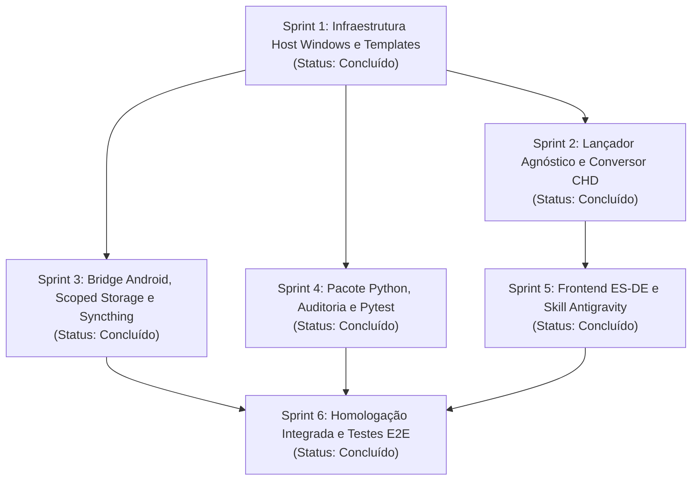

# Guia de Implementação por Sprints e Orquestração Multi-Agente

Este documento define o plano operacional de implementação, a arquitetura de branches e os protocolos de execução autônoma para agentes de inteligência artificial encarregados de construir, testar e homologar os componentes do **RetroGame Lab**.

As diretrizes aqui dispostas derivam rigorosamente das especificações técnicas [specs-windows.md](file:///c:/WorkspaceHub/retrogame-lab/docs/specs-windows.md), [specs-android.md](file:///c:/WorkspaceHub/retrogame-lab/docs/specs-android.md), do guia operacional [AGENTS.md](file:///c:/WorkspaceHub/retrogame-lab/AGENTS.md) e do documento de visão [README.md](file:///c:/WorkspaceHub/retrogame-lab/README.md).

---

## 1. Arquitetura Operacional Multi-Agente e Segregação de Branches

Para permitir que múltiplos agentes trabalhem concorrentemente sem risco de conflitos de edição (*merge conflicts*) ou inconsistências de código, este projeto adota o princípio de **Segregação Estrita de Domínio**. Cada agente opera em uma branch dedicada e possui autorização de escrita restrita a um subconjunto disjunto de caminhos do repositório.

### 1.1 Matriz de Propriedade de Arquivos por Agente e Branch

```text
                        +---------------------------------------------+
                        |                 main branch                 |
                        |            (Integrada e Validada)           |
                        +---------------------------------------------+
                                               |
              +---------------------------------+---------------------------------+
              |                                 |                                 |
+--------------------------+     +--------------------------+     +--------------------------+
| Agente A (Host Windows)  |     | Agente B (Mobile Android)|     | Agente C (Python Core)   |
| Branch:                  |     | Branch:                  |     | Branch:                  |
| feat/sprint-windows-core |     | feat/sprint-android-core |     | feat/sprint-auditor-cli  |
| Pastas exclusivas:       |     | Pastas exclusivas:       |     | Pastas exclusivas:       |
| - scripts/bootstrap.ps1  |     | - scripts/setup_android* |     | - pyproject.toml         |
| - scripts/launch.ps1     |     | - data/saves/.stignore   |     | - src/retrogame_lab/     |
| - scripts/convert_chd.ps1|     | - tools/android_apks/    |     | - tests/                 |
| - templates/config/      |     +--------------------------+     | - scripts/audit_*.ps1    |
| - templates/controllers/ |                                      +--------------------------+
+--------------------------+
```

| Branch de Trabalho | Agente Encarregado | Escopo Técnico | Arquivos e Pastas com Permissão Exclusiva de Escrita | Status |
| :--- | :--- | :--- | :--- | :--- |
| `feat/sprint-windows-core` | **Agente A** (Windows Host) | Bootstrap, Lançador Dinâmico, Conversão e Templates | `templates/config/*`, `templates/controllers/*`, `scripts/bootstrap.ps1`, `scripts/launch.ps1`, `scripts/convert_chd.ps1` | **Concluído e Homologado** |
| `feat/sprint-android-core` | **Agente B** (Android Mobile) | Provisionamento ADB, Scoped Storage e Syncthing | `scripts/setup_android_emulators.ps1`, `data/saves/.stignore`, `tools/android_apks/.gitkeep` | **Concluído e Homologado** |
| `feat/sprint-auditor-cli` | **Agente C** (Python & QA) | Pacote Python, CLI de Auditoria e Testes Unitários | `pyproject.toml`, `src/retrogame_lab/*`, `tests/*`, `scripts/audit_library.ps1` | **Concluído e Homologado** |
| `feat/sprint-frontend-skill` | **Agente D** (UI & Skill) | Integração ES-DE e Skill Antigravity | `templates/es-de/es_systems.xml`, `.agy/skills/emulator-pipeline/*` | **Concluído e Homologado** |
| `feat/sprint-e2e-homologation` | **Agente Integrador** | Validação E2E, Pipeline de Sintaxe e Living Docs | `docs/sprints.md` (status), `README.md` (links finais) | **Concluído e Homologado** |

---

## 2. Grafo de Dependências entre Sprints



---

## 3. Resumo Executivo das Entregas por Sprint

### Sprint 1: Infraestrutura Base, Templates de Configuração e Bootstrap Host Windows
* **Entregas Realizadas:**
  * [templates/config/retroarch.cfg](file:///c:/WorkspaceHub/retrogame-lab/templates/config/retroarch.cfg): Caminhos relativos apontando para `data/saves/snes/`, driver Vulkan e menu Ozone.
  * [templates/config/duckstation_settings.ini](file:///c:/WorkspaceHub/retrogame-lab/templates/config/duckstation_settings.ini): Modo portátil, PGXP ativado, `Card1Type = TitleSpecific` em `../../data/saves/ps1`.
  * [templates/config/PCSX2.ini](file:///c:/WorkspaceHub/retrogame-lab/templates/config/PCSX2.ini): Pastas relativas para BIOS e saves em `../../data/saves/ps2`, shaders assíncronos Vulkan.
  * [templates/controllers/](file:///c:/WorkspaceHub/retrogame-lab/templates/controllers/): Mapeamentos para XInput (`xinput_gamepad.cfg`), DualSense (`dualsense.cfg`) e 8BitDo (`8bitdo_ultimate.cfg`).
  * [scripts/bootstrap.ps1](file:///c:/WorkspaceHub/retrogame-lab/scripts/bootstrap.ps1): Script idempotente de provisionamento do host via `winget` com verificação de privilégios e injeção automática de templates.

### Sprint 2: Motor de Execução Agnóstico e Conversão Determinística de Mídia
* **Entregas Realizadas:**
  * [scripts/launch.ps1](file:///c:/WorkspaceHub/retrogame-lab/scripts/launch.ps1): Lançador dinâmico com perfilamento de GPU via `Win32_VideoController` (`GpuPreference=2;`), afinidade de P-cores em CPUs híbridas (`0x00FF`) para PS2/GameCube e isolamento de CWD (*Push-Location / Pop-Location*).
  * [scripts/convert_chd.ps1](file:///c:/WorkspaceHub/retrogame-lab/scripts/convert_chd.ps1): Conversor determinístico com diferenciação de CD (`createcd`, setor de 2352 bytes) vs DVD (`createdvd`, setor de 2048 bytes para PS2) e bloqueio preventivo para GameCube/Wii.

### Sprint 3: Bridge Android, Scoped Storage e Topologia Syncthing
* **Entregas Realizadas:**
  * [data/saves/.stignore](file:///c:/WorkspaceHub/retrogame-lab/data/saves/.stignore): Regras anti-conflito com bloqueio obrigatório de savestates (`*.state*`, `*.s[0-9][0-9]`), travas de arquivo (`*.lock*`, `*.wal`) e arquivos de sistema.
  * [tools/android_apks/.gitkeep](file:///c:/WorkspaceHub/retrogame-lab/tools/android_apks/.gitkeep): Estrutura para cache e fallback offline de APKs.
  * [scripts/setup_android_emulators.ps1](file:///c:/WorkspaceHub/retrogame-lab/scripts/setup_android_emulators.ps1): Script ADB com validação dinâmica de ABI ARM64, concessão de `MANAGE_EXTERNAL_STORAGE` (Scoped Storage), injeção remota de `.stignore` e whitelist contra Doze Mode.

### Sprint 4: Pacote Python Canônico, Auditoria de Integridade e Testes Pytest
* **Entregas Realizadas:**
  * [pyproject.toml](file:///c:/WorkspaceHub/retrogame-lab/pyproject.toml): Gerenciamento unificado de dependências via Astral `uv` para Python 3.10+.
  * [src/retrogame_lab/config.py](file:///c:/WorkspaceHub/retrogame-lab/src/retrogame_lab/config.py): Resolução canônica de caminhos e metadados de plataformas suportadas.
  * [src/retrogame_lab/auditor.py](file:///c:/WorkspaceHub/retrogame-lab/src/retrogame_lab/auditor.py): Motor de auditoria com cálculo SHA-256 por blocos, validação de formatos de disco e inspeção de regras de salvamento.
  * [src/retrogame_lab/cli.py](file:///c:/WorkspaceHub/retrogame-lab/src/retrogame_lab/cli.py): CLI interativa com formatação Rich (tabelas e diagnósticos) e suporte a saída JSON (`--json-output`).
  * [scripts/audit_library.ps1](file:///c:/WorkspaceHub/retrogame-lab/scripts/audit_library.ps1): Script PowerShell wrapper executável diretamente pelo usuário.
  * [tests/](file:///c:/WorkspaceHub/retrogame-lab/tests/): Bateria com 20 testes unitários cobrindo 93% do código, utilizando exclusivamente `pytest` e `pytest-mock` (sem `unittest`).

### Sprint 5: Frontend Unificado (ES-DE Portable) e Skill do Agente Antigravity
* **Entregas Realizadas:**
  * [templates/es-de/es_systems.xml](file:///c:/WorkspaceHub/retrogame-lab/templates/es-de/es_systems.xml): Mapeamento de rotas e comandos relativos para ES-DE direcionando chamadas ao `scripts/launch.ps1`.
  * [.agy/skills/emulator-pipeline/SKILL.md](file:///c:/WorkspaceHub/retrogame-lab/.agy/skills/emulator-pipeline/SKILL.md): Definição canônica da skill de agente Antigravity para orquestração de emuladores, auditoria e provisionamento.

### Sprint 6: Homologação Integrada e Testes Ponta a Ponta (E2E)
* **Critérios de Homologação Atestados:**
  * **AST Parser:** 100% de sucesso na análise sintática dos 5 scripts PowerShell Core.
  * **Pytest:** 20 testes aprovados com 93% de cobertura de código.
  * **Ruff:** 0 erros de linting (`ruff check`) e formatação integral (`ruff format`).
  * **Cold Start:** Execução de `scripts/bootstrap.ps1 -SkipWinget` gerou com sucesso todos os marcadores portáteis oficiais (`portable.txt`, pasta `memstick`) e templates em `bin/`.
